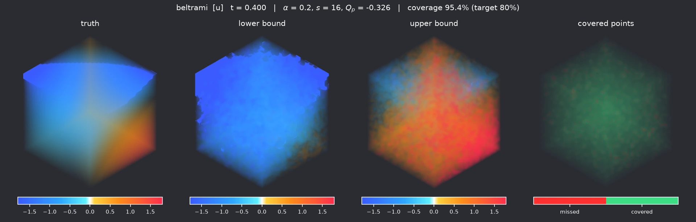
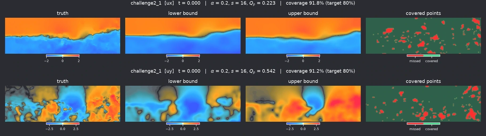

# SFCQR for neural PDE surrogate modelling

Uncertainty quantification for neural surrogates of PDE dynamics, using
**SFCQR** (split *functional* conformalised quantile regression) on top of
ensembles of quantile regressors. Two model families are supported:

- **UNet3d / UViT** (a 3D U-Net with axial self-attention, adapted from
  [`swirl_dynamics`](https://github.com/google-research/swirl-dynamics)),
  learning a one-step map from a noisy field to the field `t` later.
- **DeepONet**

Everything is written in JAX / Flax and runs on a single GPU.

Problems:

| `type` | Problem | Source | Grid | Channels |
|---|---|---|---|---|
| `beltrami` | 3D Beltrami flow (exact Navier–Stokes solution) | analytic, [data/beltramiDataGeneration.py](data/beltramiDataGeneration.py) | `res³` on `[-1,1]³` | u, v, w, p |
| `ks3d` | 3D Kuramoto–Sivashinsky | simulated with [APEBench](https://github.com/tum-pbs/apebench), [data/ks3dDataGeneration.py](data/ks3dDataGeneration.py) | `res³`, periodic | u |
| `challenge2_1` | 2D flow, Challenge 2.1 | HDF5 files in `./dataset`, [data/challengeDataLoading.py](data/challengeDataLoading.py) | 152 × 48 × 1 | ux, uy |
<!-- | `challenge2_2` | 2D pitching airfoil, Challenge 2.2 (one `case`) | HDF5 files in `./dataset` | 56 × 56 × 1 | ux, uy | -->
| `burgers` | d-dimensional viscous Burgers (DeepONet only) | analytic, [data/burgersDataGeneration.py](data/burgersDataGeneration.py) | random points in `[-5,5]^d × [0,10]` | u |

---

## Animations

<!--
  Put the files in assets/animations/ with the names below.
  GIFs render inline from a relative path. GitHub only plays .mp4 inline when it
  is uploaded through the web editor (drag it into the README edit box, which
  gives a https://github.com/user-attachments/... URL); a committed .mp4 shows
  as a plain link. Keep each file under ~10 MB.
-->

<!-- ### Burgers: DeepONet

<p align="center">
  
</p>

*TODO: caption. For example: true solution and calibrated band
`[q̄_lo − Q_p·σ, q̄_hi + Q_p·σ]` over time for one test viscosity, with
`α = 0.2`, `β = 0.2` and `s = 16` members.* -->

### Beltrami flow: UViT

<p align="center">
  
</p>

True field, lower and upper bounds and interval width for one channel over the test snapshots, preset `sfcqr_beltrami_adamw`.

<!-- *TODO: caption. For example: true field, lower and upper bounds and interval width for one channel over the test snapshots, preset `sfcqr_beltrami_adamw`.* -->

### Challenge 2.1: UViT

<p align="center">
  
</p>

True `ux`/`uy`, calibrated bounds and covered points over the test snapshots, preset `sfcqr_challenge_adamw`.

<!-- *TODO: caption. For example: true `ux`/`uy`, calibrated bounds and covered points over the test snapshots, preset `sfcqr_challenge_adamw`.* -->

---

## Method

For each miscoverage level `α` in `config.alpha_list`:

1. **Train a pool of quantile regressors.** Two groups of networks are trained
   with the pinball loss, one at `τ_lo = α/2` and one at `τ_hi = 1 − α/2`.
   Members are trained in *batches* (`--batch_n_ens` members at once, vmapped
   in a single train state); running the training script with
   `--batch_idx = 0, 1, …` grows the pool without retraining earlier batches.
2. **Calibrate** on held-out functions (time snapshots for the field problems,
   viscosities for Burgers). For each sub-ensemble size `s` and each of
   `n_repeats` draws, pick `s` random lo members and `s` random hi members from
   the pool and compute
   - consensus bounds `q̄_lo`, `q̄_hi` = member means,
   - local scale `σ = max(q̄_hi − q̄_lo, 0) + δ` ; `δ` is a tiny floor (`1e-6 × std` of the training targets),
   - normalised residual at each grid point
     `r = max(q̄_lo − y, y − q̄_hi) / σ`,
   - per-function score `S_i` = the `⌈(1−α)m⌉`-th smallest residual over the
     `m` points of function `i` (per channel),
   - threshold `Q_p` = the `⌈(n_cal+1)(1−β)⌉`-th smallest `S_i`.
3. **Evaluate** on test functions with the band
   `[q̄_lo − Q_p·σ, q̄_hi + Q_p·σ]`, replaying *exactly* the member subset that
   produced each `Q_p`. Two metrics are reported per channel:
   - **pointwise coverage** (target `1 − α`) and mean interval width,
   - **functional coverage**: fraction of test functions with at least
     `⌈(1−α)m⌉` of their points covered (target `1 − β`).

Because every ensemble size gets `n_repeats` draws, the plots show mean
coverage / width versus ensemble size `s` with error bands.

### Data split (field problems)

All field problems are a single trajectory of `T` snapshots. The model maps the
noisy observation `obs[i]` to the snapshot two steps ahead (time input
`2·dt`).

- **Train:** odd `i` from a seeded permutation, first `T // 4` of them.
  Target `obs[i+2]` (noisy).
- **Calibrate:** the remaining odd `i`. Target `gt[i+2]` (clean).
- **Test:** even inputs `obs[2+2k]` with truth `gt[4+2k]`,
  `k < num_unroll_steps`. Each step is a one-step prediction from an
  observation; there is no autoregressive feedback.

The split is written once to `<workdir>/split.npz` by the first training batch
and reused by every later batch, by calibration and by analysis, so the
calibration set can never leak into training. Delete it only if you mean to
start the experiment over.

Observation noise is Laplace with scale `noise_std`. All fields are used raw
(no normalisation), so intervals are in the data's own units.

---

## Repository layout

```
.
├── train_ensemble_pool.py          # UNet: train one batch of the pool
├── calibrate_sfcqr.py              # UNet: SFCQR Q_p vs ensemble size
├── analysis_pool.py                # UNet: test coverage / width plots
├── train_burgers_pool.py           # DeepONet/Burgers: train one batch
├── calibrate_burgers_pool.py       # DeepONet/Burgers: calibrate
├── analysis_burgers_pool.py        # DeepONet/Burgers: analyse
├── train_beltrami_don_pool.py      # UViT-DeepONet/Beltrami: train one batch
├── calibrate_beltrami_don_pool.py  # UViT-DeepONet/Beltrami: calibrate
├── analysis_beltrami_don_pool.py   # UViT-DeepONet/Beltrami: analyse
│
├── configs/
│   ├── config.py                   # UNet preset registry (get_config)
│   ├── presets.py                  # UNet presets (Beltrami, KS3D, Challenge)
│   ├── burgers_config.py           # DeepONet/Burgers presets (+ _d<N> suffix)
│   └── beltrami_don_config.py      # UViT-DeepONet/Beltrami presets
├── data/                           # data generation / loading per problem
├── model/
│   ├── unet3d.py                   # UNet3d (UViT): DStack + UStack + Fourier time embedding
│   ├── don.py                      # MLP DeepONet ensemble + quantile loss
│   └── uvit_don.py                 # DeepONet with UNet3d encoder as branch, samplers
├── stacks/                         # U-Net down (dstack3d) / up (ustack3d) stacks
├── layers/                         # conv blocks, axial attention, resize, residual
├── embeddings/fourier_emb.py       # Fourier embedding of the time input
├── train/                          # trainer loop, train state, callbacks, models,
├── utils/                          # dataloaders, plotting, pool utilities for DON runs
│
├── sbatch_scripts/{beltrami,burgers,challenge,ks3d}/
│                                   # Slurm (*.sbatch) and Docker (*_docker.sh) scripts
├── results/                        # per-experiment outputs (see below)
├── assets/animations/              # animations shown in the README
└── Dockerfile                      # environment (NVIDIA JAX image + deps)
```

---

## Environment

The environment is the NVIDIA JAX container plus a few packages (see the
[Dockerfile](Dockerfile)): `flax`, `optax`, `orbax-checkpoint`, `clu`,
`ml-collections`, `tensorflow-cpu`, `tensorboard`, `matplotlib`, `seaborn`,
`pyvista`, `apebench`, `h5py`, `tqdm`. A prebuilt image is on Docker Hub as
`dibyakanti/jax-csf3:latest`.

- **Docker (e.g. Ronin, any single-GPU machine)**
  ```bash
  docker pull dibyakanti/jax-csf3:latest
  ```
- **Singularity (CSF3)**: the Slurm scripts expect the image at
  `./singularity/jax-csf3_latest.sif` (gitignored), e.g.
  ```bash
  mkdir -p singularity
  singularity pull singularity/jax-csf3_latest.sif docker://dibyakanti/jax-csf3:latest
  ```

The Challenge problems also need the HDF5 files in `./dataset/` (gitignored):
`Challenge2_1_train.h5`, `Challenge2_1_parameters.h5`,
`Challenge2_2_train.h5`, `Challenge2_2_parameters.h5`.

All scripts must be run **from the repository root**, because configs use
relative paths (`./results/...`, `./dataset`).

---

## Running

Every pipeline has three steps: **train** the pool (one or more batches), then
**calibrate**, then **analyse**. The preset is chosen with `EXP_NAME`, which
the launch scripts pass as `--config=<config file>:${EXP_NAME}`.

### On CSF3 (Slurm + Singularity)

UNet on Beltrami / KS3D / Challenge (presets from [configs/config.py](configs/config.py)):

```bash
mkdir -p outputs/slurm

# 1. Train the pool: 10 batches × 16 members, sequentially in one job ...
EXP_NAME=sfcqr_beltrami_adamw sbatch sbatch_scripts/beltrami/pool_beltrami_sfcqr.sbatch
#    ... or one array task per batch (create split.npz first, e.g. by running
#    batch 0 alone with --array=0, so tasks don't race to create it)
EXP_NAME=sfcqr_beltrami_adamw sbatch sbatch_scripts/beltrami/pool_beltrami_array_sfcqr.sbatch

# 2. Calibrate (s = 1,2,4,…,16, 5 repeats each)
EXP_NAME=sfcqr_beltrami_adamw sbatch sbatch_scripts/beltrami/pool_beltrami_calibrate_sfcqr.sbatch

# 3. Analyse
EXP_NAME=sfcqr_beltrami_adamw sbatch sbatch_scripts/beltrami/pool_analysis_beltrami_calibrate_sfcqr.sbatch
```

Set `PREDICT_CHUNK_SIZE` (default 4 for calibration, 8 for analysis) lower if
you hit GPU out-of-memory errors. The KS3D and Burgers equivalents are in
`sbatch_scripts/ks3d/pool_*` and `sbatch_scripts/burgers/pool_*`.

### On a single-GPU machine (Docker)

Run these inside `tmux`/`screen` (or with `nohup`) so they survive SSH
disconnects. Each script mounts the repo at `/app` and logs to
`outputs/docker/`.

```bash
tmux new -s sfcqr

# Burgers (DeepONet), d = 1 by default; e.g. EXP_NAME=burgers_sfcqr_d5 for d = 5
EXP_NAME=burgers_sfcqr bash sbatch_scripts/burgers/pool_burgers_sfcqr_docker.sh
EXP_NAME=burgers_sfcqr bash sbatch_scripts/burgers/pool_burgers_calibrate_sfcqr_docker.sh
EXP_NAME=burgers_sfcqr bash sbatch_scripts/burgers/pool_burgers_analysis_sfcqr_docker.sh

# Beltrami with the UViT-DeepONet
bash sbatch_scripts/beltrami/pool_beltrami_don_sfcqr_docker.sh
bash sbatch_scripts/beltrami/pool_beltrami_don_calibrate_sfcqr_docker.sh
bash sbatch_scripts/beltrami/pool_beltrami_don_analysis_sfcqr_docker.sh

# Challenge data (UNet)
EXP_NAME=sfcqr_challenge_adamw bash sbatch_scripts/challenge/pool_challenge_sfcqr_docker.sh
EXP_NAME=sfcqr_challenge_adamw bash sbatch_scripts/challenge/pool_challenge_calibrate_sfcqr_docker.sh
EXP_NAME=sfcqr_challenge_adamw bash sbatch_scripts/challenge/pool_challenge_analysis_sfcqr_docker.sh

# Beltrami, larger dataset (~100 train / 100 cal / 100 test): all three steps
# in one script; re-running skips batches that already have a final checkpoint
nohup setsid bash sbatch_scripts/beltrami/pool_beltrami_n100_chain_docker.sh \
    > outputs/docker/chain-beltrami-n100.out 2>&1 &
```

### Script flags

| Script | Flag | Meaning |
|---|---|---|
| `train_*` | `--batch_idx` | Which batch this is; seeds its members' initialisation. Does not change the split. |
| | `--batch_n_ens` | Members trained together in this batch. **Must be the same** at calibration/analysis. |
| `calibrate_*` | `--n_ens_sub_list` | Comma-separated sub-ensemble sizes `s`, e.g. `1,2,4,8,16`. Sizes larger than the pool are skipped. |
| | `--n_repeats` | Random member subsets per `s`. |
| | `--subsample_seed` | Seed for drawing subsets. |
| `calibrate_*`, `analysis_*` | `--predict_chunk_size` | Pool members passed through the network at once (memory vs speed). |

Any config field can be overridden on the command line, e.g.
`--config.total_train_steps=2000 --config.workdir=./results/my_run`.

---

## Configuration

UNet presets live in [configs/presets.py](configs/presets.py) and must also be
registered in `get_config` in [configs/config.py](configs/config.py). Key
fields:

| Field | Meaning |
|---|---|
| `type` | `beltrami`, `ks3d`, `challenge2_1`, `challenge2_2` |
| `res`, `time_steps`, `dt` | Grid resolution, number of snapshots, time step (`res=None` for Challenge: the loader sets the grid) |
| `noise_std` | Laplace observation-noise scale |
| `model.num_channels` / `use_spatial_attention` / `downsample_ratio` | U-Net width, axial attention and downsampling per level; `res` must be divisible by the product of the ratios |
| `optimizer` | `adamw` (default), or `asgld`, `adamsgld`, `adamwnoise` (Langevin-type variants in [train/optimizer.py](train/optimizer.py)) |
| `learning_rate`, `batch_size`, `total_train_steps` | Training |
| `alpha_list` | Pointwise miscoverage levels `α` (one pair of lo/hi quantile pools each) |
| `beta` | Functional miscoverage level `β` |
<!-- | `variant` | Scale `σ`: `"A"` (interval width) or `"B"` (width + member spread) | -->
| `num_unroll_steps` | Number of test snapshots |
| `workdir` | Output directory, `./results/<preset name>` |

Main UNet presets: `sfcqr_[smallnn_]beltrami_adamw`,
`sfcqr_smallnn_beltrami_adamw_trainlonger`,
`sfcqr_beltrami_adamw_n100`, `sfcqr_[smallnn_]ks_adamw`,
`sfcqr_[smallnn_]challenge_adamw`,
`sfcqr_[smallnn_]challenge2_2_adamw`. `smallnn` variants use a two-level
U-Net.

DeepONet presets:

- [configs/burgers_config.py](configs/burgers_config.py): `burgers_sfcqr`,
  `burgers_sfcqr_variantB`, `burgers_sfcqr_smoke`. Append `_d<N>` to set the
  spatial dimension (the workdir gets the same suffix).
- [configs/beltrami_don_config.py](configs/beltrami_don_config.py):
  `beltrami_don_sfcqr` (cyclic-symmetry augmentation, hold-then-cosine lr),
  `beltrami_don_sfcqr_baseline`, `beltrami_don_sfcqr_smoke`. The data and split
  match `sfcqr_smallnn_beltrami_adamw`, so it is directly comparable to
  the UNet run.

The `*_smoke` presets finish in minutes and are useful for checking a pipeline
end to end.

---

## Outputs

UNet runs (`results/<preset>/`):

```
split.npz                              # train_idx / cal_idx (shared by every step)
alpha_<α>/
  lo/batch_<i>/checkpoints/<step>/     # orbax checkpoint, batch_n_ens members
  hi/batch_<i>/checkpoints/<step>/
  qp_by_ensemble_size.npz              # n_ens_<s>: Q_p [n_repeats, channels]
                                       # n_ens_<s>_lo_idx / _hi_idx: member indices
analysis_pool_plots/
  SCQR_Coverage_lineplot_<ch>_lr<lr>.png
  SCQR_Interval_lineplot_<ch>_lr<lr>.png
  SCQR_FunctionalCoverage_lineplot_<ch>_lr<lr>.png
```

DeepONet runs use the same layout with an extra learning-rate level, `alpha_<α>/lr_<lr>/<lo|hi>/batch_<i>/{params/, meta.json, loss_log.npy}`, and also save raw metrics to `analysis_pool_metrics_lr_<lr>.npz`. Plots go to `<workdir>/analysis_pool_plots/`.

Checkpoints (`results/*/alpha*`) are gitignored; `split.npz`, the plots and the metric files are committed.

---

## Notes and known issues

- **Reproducibility.** `train_ensemble_pool.py` seeds each quantile's trainer
  with `hash(label)`, and Python randomises string hashes per process, so member
  initialisations differ between runs unless `PYTHONHASHSEED` is fixed. The
  split and the calibration subsets are seeded and reproducible.
- Importing the data modules turns on `jax_enable_x64` globally.
- `analysis_pool.py` defines no flags of its own; it gets `--config`,
  `--batch_n_ens` and `--predict_chunk_size` by importing `calibrate_sfcqr.py`.

Please raise issues on git or mail regarding the issues to `dibyakanti.kumar@manchester.ac.uk`.

---

## Acknowledgements and licence

The U-Net, layers, stacks, trainer, train state and callbacks are adapted from Google's [`swirl_dynamics`](https://github.com/google-research/swirl-dynamics) (Apache 2.0); those files keep their original headers. The rest of the repository is released under the [MIT License](LICENSE).
